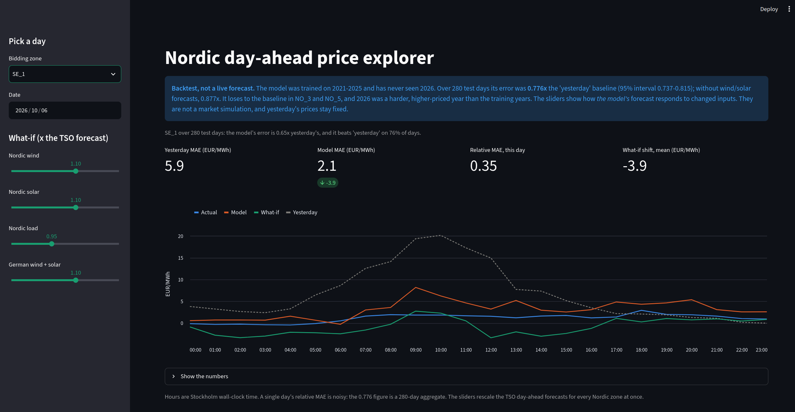
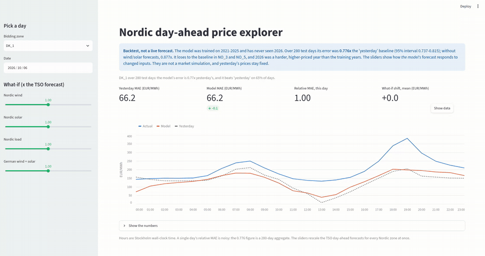

# European Energy Market Analytics & Price Forecasting Engine


**Day-ahead electricity price forecasts for 12 Nordic bidding zones, built on real ENTSO-E grid data, judged on a strict held-out year, and explorable day by day in an interactive backtest dashboard.**



## Results at a glance

Scores are relative MAE: the model's mean absolute error divided by that of the naive forecast "same hour yesterday" (1.0 = no better than yesterday, lower is better).



| Evaluation | Relative MAE | Notes |
|---|---|---|
| Cross-validation, 2023-2025 (mean of three folds) | 0.706 | where the model was chosen |
| **Held-out test, 1 Jan - 7 Oct 2026, scored once** | **0.776** (95% interval 0.737-0.815) | MAE 19.1 against about 24.6 EUR/MWh for the baseline |
| Same test without the wind/solar forecasts | 0.877 (0.846-0.908) | the lower bracket for the forecast-timing question |

The model beats the baseline in 10 of 12 zones and on 62.5% of zone-days. It is weaker than cross-validation suggested. 2026 was a harder, higher-priced year (mean price 80 against 45 EUR/MWh in 2025), and in two Norwegian zones (NO3, NO5) the model loses to the baseline. Two explanations fit that, and neither has been tested: price levels the model rarely saw, and reservoir levels that no feature describes. Details are in [Modeling & Results](#modeling--results).

## What makes this more than a model in a notebook

- **No leakage by construction.** Every feature is something that existed before the 12:00 day-ahead auction close. Tests assert that no same-hour actual is a feature and that every price lag is at least 24 hours.
- **Honest evaluation.** Expanding-year cross-validation, predictions and adoption rules written down before each experiment, the 2026 test set scored once with nothing changed afterwards, and bootstrap intervals over whole days because hourly errors within a day are correlated.
- **Tested, and the tests are tested.** 54 tests; the important ones were verified by deliberately breaking the code and watching the right test fail (see [Testing & Quality](#testing--quality)).
- **Reproducible engineering.** GitHub Actions CI, pre-commit hooks, and Docker images for the tests and for the dashboard, built so the API token never enters an image.
- **A dashboard that states its limits.** It replays only days the model never trained on, and its what-if sliders show the model's response, not a market simulation (see [the dashboard](#dashboard-the-forecast-explorer)).

## Looking at it, and running it

The data comes from ENTSO-E and needs a free API token, so it is not included in this repository. The screenshot and demo above show the dashboard without running anything. To reproduce everything, follow [Reproducing This Project](#reproducing-this-project): a handful of commands plus a data pull that takes a while the first time.

This project contains data from the ENTSO-E Transparency Platform. None of that data is redistributed here.

## Scope

The pipeline ingests day-ahead prices, actual load and generation by source, and the grid operators' own day-ahead forecasts of load and wind/solar output. It stores them as Parquet queried through DuckDB, builds forecast-safe features with Polars, trains gradient-boosted models with scikit-learn and XGBoost, and serves a Streamlit explorer for backtested days.

## Data Sources

Data is pulled directly from the **ENTSO-E Transparency Platform** REST API using the official Python client wrapper, [`entsoe-py`](https://github.com/EnergieID/entsoe-py).

**Why not OPSD?** While Open Power System Data (OPSD) was historically a popular aggregated research repository, it is no longer actively updated. Querying ENTSO-E directly ensures access to authoritative, live, hourly-updated transmission system data straight from European TSOs — including data recent enough to support a realistic train/test split.

**Datasets per zone and hour:** day-ahead price (EUR/MWh), actual load, actual generation by source, and the TSOs' day-ahead forecasts of load and of wind/solar generation.

**Zones covered (12 bidding zones):**

| Zone | Area | Country | Time zone |
|------|------|---------|-----------|
| SE1 | Luleå | Sweden | Europe/Stockholm |
| SE2 | Sundsvall | Sweden | Europe/Stockholm |
| SE3 | Stockholm | Sweden | Europe/Stockholm |
| SE4 | Malmö | Sweden | Europe/Stockholm |
| NO1 | Oslo | Norway | Europe/Oslo |
| NO2 | Kristiansand | Norway | Europe/Oslo |
| NO3 | Trondheim | Norway | Europe/Oslo |
| NO4 | Tromsø | Norway | Europe/Oslo |
| NO5 | Bergen | Norway | Europe/Oslo |
| DK1 | West | Denmark | Europe/Copenhagen |
| DK2 | East | Denmark | Europe/Copenhagen |
| FI | — | Finland | Europe/Helsinki |

Zones, their countries and their time zones live in one place, `src/energy_forecaster/config.py`, so the library can be pointed at other regions by editing a single dictionary.

**Historical range:** 2021-01-01 to present.

## Key Design Decisions

- **Python 3.12, after starting on 3.14** → Development began on the newest available Python release, but several core dependencies (`polars`, `duckdb`, `xgboost`, `shap`) didn't yet have stable prebuilt wheels for it, risking slow or broken source-compiled installs. Standardizing on 3.12 traded a few months of "newest version" for a reliable, reproducible environment.
- **Hourly resolution as the canonical grain** → On October 1, 2025, Europe's entire day-ahead electricity market (Nord Pool included) switched from hourly to 15-minute pricing intervals across every bidding zone. Left as-is, this would silently change the data's granularity partway through the historical range, corrupting lag features and rolling averages that assume a consistent frequency. Every series is resampled to hourly at the ingestion layer, averaging each quarter-hour group where applicable, trading a small amount of intra-hour detail in the recent period for one clean, consistent multi-year series.
- **Multi-country Nordic scope (12 zones)** → Bidding zones don't exist in isolation; cross-border transmission flows and regional weather patterns heavily influence localized prices. Modeling interconnected zones together supports capturing spatial feature interactions (e.g., a wind generation surplus in DK1 depressing prices in SE3).
- **`src/` layout package structure** → Enforces a clean separation between runnable scripts (`scripts/`) and reusable core library logic (`src/energy_forecaster/`), avoiding import-path ambiguity and enabling a proper editable install (`pip install -e .`) for development.
- **DuckDB + Parquet as the storage and query layer** → Analytical tables are stored as columnar `.parquet` files and queried via DuckDB, which runs in-process while still supporting multi-gigabyte aggregations, CTEs, and window functions directly over the files on disk.
- **Forecast-safe features only** → The day-ahead auction for day D closes at 12:00 on day D-1, so a feature is usable only if it would have existed at that moment. Price lags are at least 24 hours; lags of actual load and generation are at least 48 hours; and the wind, solar and load picture for the target day comes from the TSOs' own day-ahead forecasts, never from same-hour actuals. The joined `hourly_dataset.parquet` contains same-hour actuals (they are needed to build lags), so it is *not* safe to feed to a model directly, `build_feature_table` produces the safe table, and drops the raw generation columns once the lagged features are computed.
- **Calendar features on each zone's own clock** → Hour of day, weekday and public holidays are computed from each row's local time in its zone's time zone. Using a single clock would, for example, mark the first hour of Finland's Independence Day as an ordinary day.
- **Polars for feature engineering, pandas only at the scikit-learn boundary** → Per-zone lag and rolling features are expressed with Polars' `.over("zone")` (the equivalent of SQL's `PARTITION BY`); the data is converted to pandas only where scikit-learn requires it.
- **Preprocessing is defined now and fit later** → The `ColumnTransformer` (scaling, one-hot encoding) lives in `preprocessing.py`, but it is only ever fit on the training split, because fitting a scaler on data that includes the test period leaks the test period's distribution into the model.

- **Expanding-year cross-validation, with 2026 held out and scored once** → Folds train on all years before the evaluated year (2021–22 → 2023, 2021–23 → 2024, 2021–24 → 2025), mirroring how the model would be used. Model and feature decisions were made on those folds only; the 2026 test period was scored a single time at the end and nothing was changed afterwards.
- **Relative MAE against a "yesterday" baseline as the headline metric** → The baseline is the price of the same hour 24 hours earlier, the strongest of several naive baselines tried. 1.0 means "no better than yesterday". RMSE is reported alongside, because a few spikes dominate it.
- **Pre-registered predictions and adoption rules** → Each experiment had its expected result and its adoption rule written down before it was run, so the outcome could not bend the decision. Misses are reported with the hits.
- **Day-level bootstrap intervals** → Hourly errors within a day are strongly correlated, so uncertainty is estimated by resampling whole days.
- **A backtest explorer, not a live forecaster** → The dashboard only offers 2026 days, which the model never trained on, so every day shown is genuinely out-of-sample. A live version would first need the wind/solar forecast vintage question below settled.
- **What-if by rescaling the day-ahead forecasts, with every derived feature rebuilt** → Scaling a base forecast and leaving its totals and shares stale would feed the model a contradictory day. One shared function recomputes all derived columns, and a test checks that it reproduces the stored table when nothing is scaled.
- **Pooled scores, not per-day ratios** → A single day's relative MAE explodes when the baseline happens to do well, so the headline and the dashboard's zone context pool the errors over all days.

## Data Quality Issues Found & Resolved

Working against a live, external data source surfaced several real data-quality issues, each tracked down from first symptom to root cause before being fixed.

### 1. Day-ahead price timestamp duplication at year boundaries

**Symptom:** Per-zone row counts in the `prices` table came in slightly higher than expected. A `GROUP BY zone, timestamp HAVING COUNT(*) > 1` check confirmed exactly two rows sharing the same zone and timestamp at `January 1st, 00:00:00` for every year boundary from 2022 onward (2021 has no earlier year to collide with).

**Investigation:** Comparing the two duplicate rows directly showed identical values at boundaries before the October 2025 resolution change, but genuinely different values afterward, the clue linking this back to the hourly → 15-minute transition above. Each year's pull requested data through `{year+1}-01-01 00:00`, inclusive.

**Root Cause:** The ENTSO-E API treats the query's `start`/`end` window as inclusive at both ends, so consecutive years' pulls both legitimately returned the shared boundary hour, once each.

**Fix:** Rather than deduplicate after the fact (which fails silently once both sides of a 15-minute-resolution boundary hold genuinely different values), each year's fetch window was kept intentionally generous, but the result is explicitly filtered to `timestamp.dt.year == year` immediately before writing to Parquet, removing the possibility of a boundary leak at the source.

### 2. Daylight Saving Time (DST) timestamp dtype collapse

**Symptom:** Applying the year-boundary fix above raised `AttributeError: Can only use .dt accessor with datetimelike values` when pulling a full calendar year, despite working correctly on every earlier single-day and single-week test.

**Investigation:** Inspecting `df["timestamp"].dtype` showed `object` instead of a proper timestamp type. `entsoe-py` returns timestamps as fixed UTC offsets (`+01:00` in winter, `+02:00` in summer for Stockholm) rather than a named timezone. A short test window never happened to cross a DST transition; a full year always does.

**Root Cause:** Pandas can only use its fast, vectorized `datetime64[ns, tz]` dtype when every value in a column shares one consistent UTC offset. A column spanning both `+01:00` and `+02:00` silently falls back to a generic `object` dtype, which lacks the `.dt` accessor.

**Fix:** Every timestamp column is explicitly reparsed with `pd.to_datetime(..., utc=True)` to force one consistent internal representation, then converted back with `.dt.tz_convert("Europe/Stockholm")`, necessary so calendar-based filtering (including the year-boundary fix above) reflects correct local-time semantics rather than UTC-shifted ones.

### 3. Silently lost points in long price requests

**Symptom:** After joining all sources, the price column had 48 nulls (12 zones × 4 timestamps, all at `Dec 31 00:00` of 2021–2024) even though the market had priced those hours. Each null also blanked a week of the rolling price features built on top.

**Investigation:** Re-requesting the missing hour in a narrow window returned it. Padding each yearly request with extra days did not fix it; it moved the null from Dec 31 to Dec 16, exactly one calendar year (minus a day) after the padded request's start. Scanning request lengths from 30 to 400 days showed no loss up to 364 days, then exactly one missing point for every request spanning a full year, at the day before its one-year mark. In the 15-minute era the lost point is a single quarter-hour, so the hourly average silently uses 3 values instead of 4 and no null gives it away. Two earlier hypotheses were disproved by direct tests before this one survived.

**Root Cause:** A prices request that spans a full calendar year drops one data point at its one-year boundary. (Observed behavior of the request path; the exact layer, client or API, was not isolated.)

**Fix:** Prices are requested in 150-day windows, each padded by two days, then merged, de-duplicated and trimmed; and the fetch raises if any point is missing between two present points, at either cadence. After a full re-pull the null counts matched the predicted warm-up values exactly.

### 4. Public-holiday calendars that count Sundays

**Symptom:** The holiday flag marked about 61–63 days per year in Sweden against 10–12 in Norway and Denmark.

**Root Cause:** The `holidays` library's Swedish calendar treats every Sunday as a public holiday by default, which would have made the feature mean "special day" in some countries and "Sunday" in others.

**Fix:** The Swedish calendar is built with `include_sundays=False`, isolated in one commented function. Sweden then falls in line with the other countries.

### 5. Zero-filled gaps in renewable forecasts

**Symptom:** Runs of exactly 0 MW of forecast wind and solar, 12 hours or longer, in zones that otherwise have both, starting at midnight, lasting whole days, and shared by all zones of a country.

**Investigation:** Querying the API directly for sample days showed two origins: days the API had no data for (which ingestion had filled with zeros) and days where the grid operator itself published zeros. The two are indistinguishable in the stored data.

**Fix:** At feature time, such runs are treated as missing: 1,577 zone-hours (about 0.26% of rows) are set to null, while zones that are entirely zero (NO5 has no wind or solar in the data) are left alone. The count matched the sum of the listed runs exactly.

## Modeling & Results

The model forecasts the hourly price of the next day in all 12 zones using only information available before the 12:00 auction close, including the grid operators' own day-ahead forecasts for the target day.

### Model ladder (cross-validation, mean relative MAE over 2023, 2024 and 2025)

| Model | Relative MAE |
|---|---|
| "Yesterday" baseline | 1.000 |
| Ridge regression | 0.977 |
| XGBoost, base features | 0.801 |
| + cross-zone forecast aggregates | 0.756 |
| + German day-ahead market features | **0.706** |

German features improved every fold (0.048, 0.054 and 0.048), most in western Denmark (0.119). A random search over 13 XGBoost configurations found a best mean of 0.698, a gain of 0.008. That is below the pre-registered threshold of 0.01, so the default settings were kept.

### Held-out test, 1 January to 7 October 2026 (scored once)

| Model | MAE | RMSE | Relative MAE | 95% interval |
|---|---|---|---|---|
| "Yesterday" baseline | about 24.6 | | 1.000 | |
| Full model | 19.1 | 28.6 | **0.776** | [0.737, 0.815] |
| Without wind/solar forecasts | 21.6 | 32.4 | **0.877** | [0.846, 0.908] |

Intervals are 95% bootstrap intervals over whole days. The model beats the baseline clearly, but **less than cross-validation suggested** (0.706). 2026 was a harder year: the mean price was 80 EUR/MWh against 45 in 2025, and the baseline's own error rose 22%. The model's error rose more (about 36%), and the loss is concentrated in the zones where prices moved most. In NO3 and NO5 the model was worse than the baseline (relative MAE 1.09). Across the 12 zones, the rank correlation between the price rise and the deterioration was 0.83. Two explanations fit this and the data cannot separate them: price levels the model rarely saw, and hydrology (reservoir levels) that no feature describes. Neither has been tested.

### What the model uses

SHAP values (model fitted on 2021–2024, explained on 2025) show that price history carries about 46% of the attribution (the previous day's price alone, 28%), the wind, solar and load forecasts about 40%, and the German features 13% combined. Calendar features are used little, because the daily shape is already in the previous day's price.

### Zone and day level

| Zone | Relative MAE (pooled, 2026) | Days the model beat "yesterday" |
|---|---|---|
| FI | 0.64 | 74% |
| SE_2 | 0.64 | 74% |
| SE_1 | 0.65 | 76% |
| SE_3 | 0.70 | 71% |
| SE_4 | 0.73 | 70% |
| DK_1 | 0.77 | 65% |
| NO_4 | 0.79 | 66% |
| DK_2 | 0.79 | 63% |
| NO_1 | 0.87 | 55% |
| NO_2 | 0.88 | 54% |
| NO_3 | 1.09 | 42% |
| NO_5 | 1.09 | 41% |

Across all zone-days the model beats "yesterday" 62.5% of the time. A single day's ratio is much noisier than the pooled one: in DK_1, five consecutive days came out at 1.00, 1.81, 3.95, 0.77 and 1.55 against a pooled 0.77. The 3.95 day had a baseline error of 7.1 against a perfectly ordinary model error of 28.1. Judged over its last 14 days (7 won, against about 9 expected), DK_1 shows no evidence of drift.

### Limitations

- **Forecast vintage.** The stored wind/solar forecasts carry no publication time, and the regulation guarantees them only by 18:00 on D-1, after the auction closes. Removing them gives a lower bracket (0.929 in cross-validation, 0.877 on the test year). Independent noise at the size of the German forecast error costs only about 0.01, so the model relies on the forecast's level more than its precision. Errors correlated across zones were not tested.
- **One test year**, and an unusual one. The interval reflects which days happened to be sampled, not a change of regime.
- **Reservoir levels are not features.** The hydro-dominated Norwegian zones are the weakest.
- **Selection effects.** Features were chosen on the same three folds used to report cross-validation scores, so 0.706 is somewhat optimistic by construction.

## Dashboard: the Forecast Explorer


A Streamlit app (`app/streamlit_app.py`) that replays any complete day of the 2026 test period for any of the 12 zones.

- **The chart** shows the actual price, the model's forecast and the "yesterday" baseline, with a table of the numbers underneath. Hours are on the Stockholm clock.
- **The numbers** give the day's MAE for the baseline and the model, the day's relative MAE, and, for the chosen zone, the 2026 pooled relative MAE and the share of days the model beat "yesterday". A zone where the model loses to the baseline over 2026 gets a visible warning.
- **Four what-if sliders** rescale the day-ahead forecasts of Nordic wind, Nordic solar, Nordic load (0.8 to 1.2 times) and German wind and solar. Every derived feature is rebuilt before the model predicts again, and a second line appears on the chart.

How the model's forecast responds to the sliders (mean change over the 2026 test rows, EUR/MWh, averaged over the zones):

| Driver | x0.5 | x1.5 |
|---|---|---|
| Wind | +13.2 | -11.4 |
| Solar | +1.5 | -1.4 |
| German wind + solar | +10.0 | -7.7 |

Load moves the forecast by -8.7 at 0.75 times and +8.9 at 1.25 times. Every response is monotone, in every zone, and every sign is economically right. Wind matters most in SE_3, SE_4, Denmark and Finland, and least in NO_4 and NO_5; German renewables matter most in Denmark.

**Read the sliders with care.**
- They show **the model's response**, not a market simulation. Yesterday's prices stay fixed, which damps the response, and the model has not seen days where wind or load differ from their forecasts by half.
- Finland's load response is convex (+34 at 1.5 times) and partly extrapolation, which is why the load slider stops at 1.2.
- A single day's relative MAE is noisy (see above); the zone caption is there for context.

The colours were checked with a palette validator in light and dark themes (an early near-black line had a contrast of 1.09 to 1 on the dark theme and was replaced).

## Testing & Quality

The test suite has 54 tests:

- **Unit tests** for the metrics, the day-level bootstrap and the train/test splits (including the New Year boundary on the local calendar).
- **Synthetic-data tests** that turn the bugs found in Phases 1 and 2 into permanent checks: lags computed inside each zone, calendar features on each zone's own clock, Swedish Sundays not counted as holidays, long zero-forecast runs treated as missing, price requests kept short of a full year, the gap guard, duplicate and tuple-shaped generation columns, and timestamps across daylight saving time.
- **Leakage guards**: no same-hour actual is a model feature, and every price lag is at least 24 hours.
- **Data-contract tests** on the real feature table (one row per zone and hour, the 24-hour lag is really 24 hours earlier, the preprocessor yields 33 columns). They skip themselves when the table has not been built.
- **Scenario tests**: scaling by 1.0 reproduces the stored table, derived totals follow the scaled columns, missing values propagate, and negative factors are rejected.
- **Dashboard-helper tests**: day selection on the Stockholm calendar (including the 23- and 25-hour daylight-saving days), complete-day detection, the day summary with missing values, and the zone context (pooled ratio, win rate, ties not counted as wins).

Each test was checked by breaking the code on purpose and confirming the right test failed. One mutation survived a first version of a test (the timestamps were already in the right time zone), so the test was rebuilt with UTC timestamps until the mutation was caught. In CI, where the data-contract tests skip, the result is 48 passed and 6 skipped, with about 50% coverage overall: 100% on config, metrics, scenarios, splits and the bootstrap, 83% on the dashboard helpers (the part that needs a fitted model is untested), 57% on feature engineering and 40% on ingestion. The model training and evaluation code is exercised by the scripts rather than by unit tests.

**Automation:** Ruff (lint and format), a pytest hook and basic file hygiene checks run on every commit through `pre-commit`; the same lint, format and test steps run on GitHub Actions for every push and pull request. No secrets are needed in CI, because no test calls the API.

## Known Data Gaps

- **Swedish load forecast, 2025-12-04:** the API returns no day-ahead load forecast for SE1–SE4 that day (96 zone-hours). Left as null.
- **Actual generation and load reporting gaps:** about 12 zone-hours where a zone's generation feed reported nothing (all four Swedish zones at 2022-03-27 23:00; Danish zones on 2025-04-08, 2025-05-08 and 2026-05-21) and 44 zone-hours of missing actual load. They break the 7-day renewable-ratio feature for the following week.
- **Zero-forecast runs:** 1,577 zone-hours nulled, as described above.
- **NO5:** no wind or solar in the data, so its renewable features are constant.
- **Warm-up rows:** lag and rolling features are null for the first hours of each zone, by construction.
- **Forecast vintage:** the data holds one forecast per hour, with no record of when it was published or revised. The pipeline assumes the forecast for day D was available before the auction closed, which is standard practice but still an assumption.

## Reproducing This Project

### 1. Clone the repository

```bash
git clone https://github.com/RoneiCO/european-energy-forecaster.git
cd european-energy-forecaster
```

### 2. Create and activate a virtual environment

```bash
python3.12 -m venv .venv
source .venv/bin/activate
```

### 3. Install dependencies

```bash
pip install -e ".[dev]"
```

### 4. Configure your ENTSO-E API token

Create an account on the [ENTSO-E Transparency Platform](https://transparency.entsoe.eu/), request API access by email (approval typically takes a few business days), and generate your token in your account settings, then create a `.env` file in the project root:

```
ENTSOE_API_KEY=your_token_here
```

### 5. Pull the data and build the tables

```bash
python scripts/pull_historical_data.py
python scripts/build_dataset.py
python scripts/build_features.py
```

The first full pull takes a while (tens of minutes per data type). Finished past years are cached permanently; the current year is re-fetched on every run.

To reproduce the modeling results:

```bash
python scripts/evaluate_baselines.py   # naive baselines per year, zone and weekday
python scripts/evaluate_models.py      # the model ladder on the cross-validation folds
python scripts/tune_xgboost.py         # random search (long: about 39 model fits)
python scripts/final_test.py           # the 2026 test, run once
python scripts/explain_model.py        # SHAP importance
python scripts/daily_view.py           # zone- and day-level view of the test predictions
python scripts/train_final_model.py    # saves models/xgb_full.joblib for the dashboard
python scripts/scenario_response.py   # how the forecast responds to the what-if levers
```

- `data/raw/` — one Parquet file per data type and year.
- `data/processed/hourly_dataset.parquet` — all sources joined by zone and hour. Contains same-hour actuals, so it is not model-safe.
- `data/processed/feature_table.parquet` — the forecast-safe, model-ready feature table.

### 6. Run the tests

```bash
pytest                                   # 54 passed with the data built; 48 passed and 6 skipped without it
pytest --cov=energy_forecaster --cov-report=term-missing
pre-commit install                       # run the checks on every commit
```

### 7. Run the dashboard

The dashboard needs the built feature table, the saved test predictions and the saved model (`models/` is not in the repository, so train it once):

```bash
python scripts/final_test.py             # if the test predictions do not exist yet
python scripts/train_final_model.py      # writes models/xgb_full.joblib and model_card.json
pip install -e ".[app]"
streamlit run app/streamlit_app.py       # http://localhost:8501
```

A joblib file can run code when loaded, and it is tied to the library versions that wrote it (the model card records them). Only load a model you trained yourself.

### 8. Or use Docker

```bash
docker build -t energy-forecaster .
docker run --rm energy-forecaster                                   # tests, without data
docker run --rm -v "$PWD/data:/app/data" energy-forecaster          # tests with the local data
docker run --rm --env-file .env -v "$PWD/data:/app/data" energy-forecaster \
    python scripts/pull_historical_data.py                          # pull data; the token is passed at run time
```

The ENTSO-E token is never copied into the image (`.env` is in `.dockerignore`).

The dashboard has its own image. It contains no data, model or token; those are mounted read-only at run time:

```bash
docker build -f Dockerfile.app -t energy-explorer .
docker run --rm -p 127.0.0.1:8501:8501 \
  -v "$PWD/data:/app/data:ro" -v "$PWD/models:/app/models:ro" energy-explorer
```

Publishing the port on `127.0.0.1` keeps the app reachable from this machine only. Without the mounts, the page shows a `FileNotFoundError` for the model.

## Project Status

- [x] Phase 1: Data ingestion, DuckDB warehouse layer, hourly modeling dataset
- [x] Phase 2: Feature engineering and leakage-free preprocessing pipeline
- [x] Phase 3: Model training & evaluation
- [x] Phase 4: Testing, CI/CD, Docker
- [x] Phase 5: Streamlit forecast explorer with what-if sliders, run locally and in Docker

## License

The code is released under the [GNU GPL License](LICENSE). The ENTSO-E data it processes is not part of this repository and remains subject to ENTSO-E's own terms.
